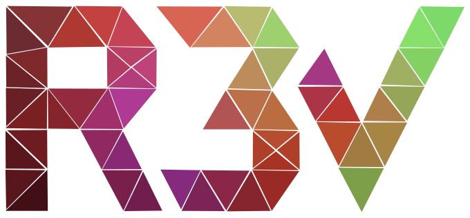
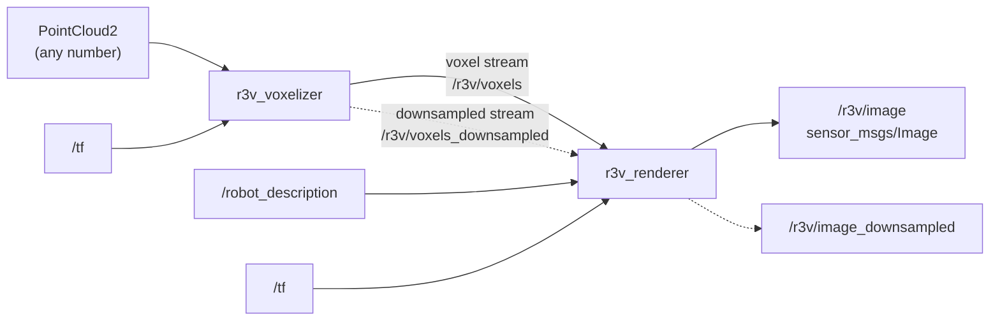

<p align="center">
  
</p>

<h1 align="center">r3v_ros</h1>

<p align="center">
  ROS 2 nodes that build a voxel map from point clouds and render it<br>
  together with the robot, published as an image stream.
</p>

<p align="center">
  <a href="https://github.com/igorosky/r3v-ros/actions/workflows/ci.yml"></a>
  <a href="https://igorosky.github.io/r3v-ros/"></a>
  
</p>

---

Give r3v_ros the point clouds of your lidars or depth cameras and get a 3D
view of the surroundings with the robot inside it, as a normal
`sensor_msgs/Image` topic. Any image viewer, a web page or a video stream can
show it, so the operator does not need a 3D client.



## Packages

The repository holds two ROS packages:

- [r3v_ros](r3v_ros): the two nodes below, with the Rust crates they are
  built on as git submodules ([r3v-voxelizer](r3v_ros/r3v-voxelizer),
  [r3v-renderer](r3v_ros/r3v-renderer)).
- [r3v_interfaces](r3v_interfaces): the voxel stream messages only, so that
  whatever only passes the stream on (rosbridge, bridges between machines) or
  renders it elsewhere (e.g. r3v-renderer's JS bindings in a browser) builds
  without Rust.

## The two nodes

- **`r3v_voxelizer`** (executable `r3v_voxelizer_node`, component
  `r3v_ros::VoxelizerNode`) takes any number of `sensor_msgs/PointCloud2`
  topics and ray casts them into an occupancy voxel map with
  [r3v-voxelizer](https://github.com/igorosky/r3v-voxelizer). It publishes the
  map as a voxel stream: changes as they happen, the whole map on request. A
  second stream carries a downsampled, coarser copy of the map (worked out
  only while someone follows it).
- **`r3v_renderer`** (executable `r3v_renderer_node`, component
  `r3v_ros::RendererNode`) follows the voxel stream and renders the map with
  the robot using [r3v-renderer](https://github.com/igorosky/r3v-renderer).
  `mode` picks the full map, the downsampled one or both (each to its own
  image topic).
  The robot comes from `/robot_description` (or a URDF file) and is posed from
  `/tf`. Meshes can be in any format assimp reads (STL, DAE, OBJ, glTF, ...),
  plus box, cylinder and sphere primitives. Rendering is headless on the GPU
  through Vulkan (or on the CPU with lavapipe).

The image goes out through `image_transport`, so `<topic>/compressed` and
every other installed transport are published too. The camera and the look of
the scene (colormap, hidden links, marching cubes, ...) can be changed at
runtime through topics.

The voxelizer and the renderer can run in one process or on different
machines, for example the voxelizer on the robot and the renderer on a base
station. One voxelizer can feed many renderers.

## Quick start

With Docker (no ROS install needed on the host):

```bash
git clone --recurse-submodules https://github.com/igorosky/r3v-ros.git
cd r3v-ros
docker build -t r3v-ros:jazzy .        # --build-arg ROS_DISTRO=humble for Humble

docker run --rm -it --net=host --ipc=host --device /dev/dri \
  -v $PWD/my_config.yaml:/config/r3v.yaml:ro \
  r3v-ros:jazzy
```

Start from a copy of [config/r3v.yaml](r3v_ros/config/r3v.yaml) as `my_config.yaml`
and set at least `fixed_frame` and your point clouds (`point_clouds.names`
and `point_clouds.<name>.topic`). The rendered view is published on
`/r3v/image`, for example `rqt_image_view` shows it.

The first build takes several minutes, mostly compiling the Rust crates. GPU
setup (Intel, AMD, NVIDIA or none), compose and robot meshes are described in
[docs/docker.md](docs/docker.md).

### Launch files

Inside a ROS workspace (see [docs/development.md](docs/development.md) to
build it):

```bash
# Everything in one process
ros2 launch r3v_ros r3v.launch.py config:=/path/to/r3v.yaml

# Or split: voxelizer on the robot, renderer on a base station
ros2 launch r3v_ros voxelizer.launch.py config:=/path/to/r3v.yaml   # robot
ros2 launch r3v_ros renderer.launch.py config:=/path/to/r3v.yaml    # base station
```

`r3v.launch.py` loads both nodes into one `component_container_mt`, where the
voxel stream goes from one to the other without the middleware (and
uncompressed; `compression:=zstd` compresses it for renderers elsewhere
following it too). The downsampled stream is zstd compressed there, as its
followers are usually elsewhere (`downsampled_compression:=none` to change
that).

When split, the renderer needs the voxel stream, TF and `robot_description`
from the robot, the voxelizer needs only the point clouds and TF. All launch
files take `config`, `namespace` and `use_sim_time`.

## Configuration

Both nodes read one parameter file. [config/r3v.yaml](r3v_ros/config/r3v.yaml)
documents every parameter. It has a section read by both nodes and one per
node (keyed by the node names `r3v_voxelizer` and `r3v_renderer`), so the same
file works for every way of running them.

## Main topics

| Topic (default) | Type | Node | |
|---|---|---|---|
| `point_clouds.<name>.topic` | `sensor_msgs/PointCloud2` | voxelizer | in |
| `/tf`, `/tf_static` | `tf2_msgs/TFMessage` | both | in |
| `/robot_description` | `std_msgs/String` | renderer | in |
| `/r3v/voxels` | `r3v_interfaces/VoxelMapUpdate` | voxelizer to renderer | stream |
| `/r3v/voxels_downsampled` | `r3v_interfaces/VoxelMapUpdate` | voxelizer to renderer | stream |
| `~/camera_pose` | `geometry_msgs/PoseStamped` | renderer | in |
| `/r3v/image` (+ transports) | `sensor_msgs/Image` | renderer | out |
| `/r3v/image_downsampled` (+ transports) | `sensor_msgs/Image` | renderer (mode `downsampled` or `both`) | out |

Every topic, including the runtime `set_*` / `get_*` control topics, is listed
in [docs/topics.md](docs/topics.md).

## Documentation

| Document | What is inside |
|---|---|
| [docs/topics.md](docs/topics.md) | All topics, views, runtime control, camera, enabling and disabling the renderer |
| [docs/voxel-stream.md](docs/voxel-stream.md) | How the voxel streams (full and downsampled) and their synchronization work |
| [docs/docker.md](docs/docker.md) | Docker image, compose, GPU access, robot meshes |
| [docs/development.md](docs/development.md) | Building without Docker, linters, tests, CI |
| [docs/notes.md](docs/notes.md) | Behavior details and migrating from `r3v_node` |

## Development

```bash
git submodule update --init --recursive
colcon build --cmake-args -DCMAKE_BUILD_TYPE=Release
colcon test --packages-select r3v_ros && colcon test-result --verbose
```

Needs ROS 2 Humble or Jazzy and Rust from rustup (`colcon build
--packages-select r3v_interfaces` builds the messages alone, without Rust). Details, linters, CI and
coverage are in [docs/development.md](docs/development.md).

## Part of r3v

| Repository | What it does |
|---|---|
| [r3v-voxelizer](https://github.com/igorosky/r3v-voxelizer) | Point clouds to occupancy voxel map |
| [r3v-renderer](https://github.com/igorosky/r3v-renderer) | Headless renderer for the voxel map and robot models |
| **r3v-ros** | ROS 2 nodes that put both together and publish images (this repository) |
| [r3v-web](https://github.com/igorosky/r3v-web) | Browser viewer for the rendered stream |
